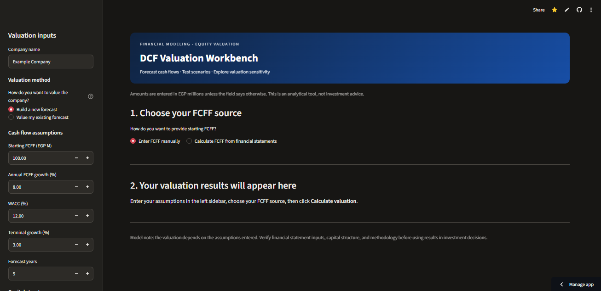

# DCF Valuation Calculator Demo
A hands-on, interactive workspace for exploring Discounted Cash Flow valuation.

  

  
  
  
  

From financial statements to valuation insights — one assumption at a time.

 About the Project
The DCF Valuation Workbench is an interactive web app designed to make DCF valuation more approachable for finance students, aspiring analysts, and anyone learning how financial assumptions shape intrinsic value.

The project is vibe-coded: built through iterative experimentation, AI-assisted coding, debugging, and a lot of learning along the way. It is an active work in progress, and its features and data-import logic are still being refined.
 Development status: This project is under improvement. Outputs are for learning and exploration—not investment advice or a substitute for independently verified financial analysis.

 What It Can Do
- DCF valuation: Explore how cash-flow assumptions, WACC, terminal growth, and capital structure affect estimated value.
- Two valuation workflows:
  - Build a new forecast — start with one FCFF value and project future cash flows using a growth assumption.
  - Value my existing forecast — use projected FCFF values already available in a workbook.
- Financial-data import: Upload Excel or CSV data and review extracted information before using it.
- Scenario analysis: Compare valuation outcomes under different assumptions.
- Sensitivity analysis: Explore how changes in WACC and terminal growth affect enterprise value.
- Visual outputs and exports: Review valuation results and export model outputs where supported.
Features may change as development continues. Some import formats and workbook layouts may require manual review.
 Built With

  
  
  
  

The import workflow is being improved to make it easier to:
- Select the relevant table or range.
- Preview the extracted data.
- Confirm the FCFF row and forecast periods.
- Avoid confusing an already-projected cash flow with a new forecast's starting FCFF.
Please review imported data and confirm that the selected cash flow is FCFF (unlevered free cash flow to the firm) before calculating a valuation.

Current Limitations
- The app is still under active development.
- Workbook layouts can vary; import results may need manual confirmation.
- Valuation outputs depend on the quality and consistency of user-provided inputs.
- The model is an educational tool and does not provide investment recommendations.

Why I’m Building It
This project is part of my journey into financial modeling, valuation, and Python-based analytical tools.
The goal is not just to calculate a number—it’s to understand how the assumptions behind that number work, and to make the process easier to explore.
Built with curiosity, iteration, and a little bit of vibe coding. 💻✨
Thanks for checking out the project!

Still learning. Still building. Still improving.
You can give it a try here: https://dcf-valuation-workbench-demo.streamlit.app/

